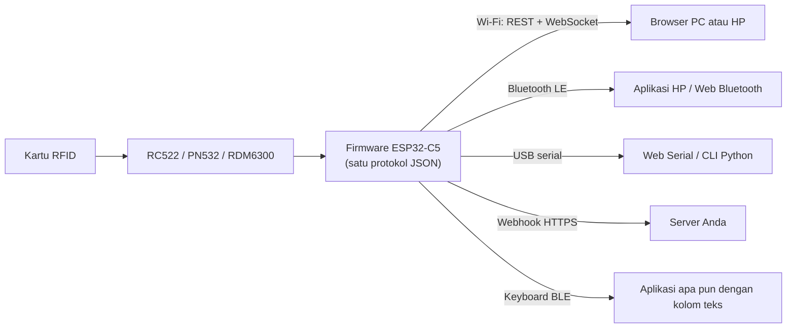

<p align="center">
  
</p>

<h1 align="center">Gapura</h1>

<p align="center">
  <b>Pembaca/penulis RFID nirkabel open source.</b><br/>
  ESP32-C5 dengan RC522, PN532, atau RDM6300, bisa dipakai HP atau PC mana pun lewat Wi-Fi, Bluetooth LE, atau USB.
</p>

<p align="center">
  <a href="https://github.com/SkillsHUB-Electronics/gapura/actions/workflows/ci.yml"></a>
  <a href="https://github.com/SkillsHUB-Electronics/gapura/actions/workflows/pages.yml"></a>
  <a href="https://github.com/SkillsHUB-Electronics/gapura/releases"></a>
  <a href="LICENSE"></a>
  
  
</p>

<p align="center">
  <a href="https://skillshub-electronics.github.io/gapura/?demo"><b>Coba demo dashboard</b></a> ·
  <a href="#mulai-cepat">Mulai cepat</a> ·
  <a href="docs/PROTOCOL.md">Protokol</a> ·
  <a href="docs/PLAN.id.md">Rencana dan roadmap</a> ·
  <a href="CONTRIBUTING.id.md">Berkontribusi</a> ·
  🇬🇧 <a href="README.md">English</a>
</p>

<p align="center">
  <picture>
    <source media="(prefers-color-scheme: dark)" srcset="docs/images/dashboard-dark.png">
    
  </picture>
</p>
<p align="center"><em>Dashboard Gapura dalam mode demo. Halaman yang sama berjalan dari perangkat di <code>http://gapura.local</code>.</em></p>

---

## Kenapa Gapura

Kebanyakan reader RFID terikat ke satu PC lewat satu kabel. Gapura adalah reader kecil bertenaga baterai yang bisa dipakai HP, tablet, atau PC mana pun lewat jalur yang sudah ada, dengan satu protokol JSON untuk semuanya. Pakai sebagai reader tetap yang mengirim data tap kartu ke server, atau sebagai reader mobile yang mengetik ID kartu ke aplikasi apa pun seperti keyboard Bluetooth.

## Fitur

- **Baca dan tulis kartu:** MIFARE Classic 1K dan NTAG/Ultralight (13,56 MHz), plus UID EM4100 125 kHz dengan RDM6300.
- **Tiga jalur, satu protokol:** Wi-Fi (REST + WebSocket, `http://gapura.local`), Bluetooth LE (Web Bluetooth dan aplikasi mobile), USB serial (Web Serial dan script).
- **Dashboard web bawaan:** mobile-first, disajikan dari perangkat, juga [online](https://skillshub-electronics.github.io/gapura/) lewat Bluetooth atau USB di Chrome dan Edge.
- **Mudah disambung ke sistem yang ada:** webhook HTTPS setiap tap, atau mode keyboard BLE HID yang mengetik ID kartu.
- **Pengamanan kartu:** kunci per kartu dan credential bertanda tangan (HMAC) di kartu yang terikat ke UID kartu, sehingga data yang diubah atau disalin ke kartu lain ditolak.
- **Bertenaga baterai:** sel 18650 dengan charger onboard, level baterai dan status pengisian, deep sleep saat baterai kritis.
- **Aman secara bawaan:** blok 0 dan sector trailer dilindungi dari penulisan, BLE butuh pairing passkey, API butuh password perangkat.
- **Mudah dirawat:** update over-the-air (firmware dan dashboard), watchdog, build CI, dan unit test native.

## Cara kerja



## Hardware

| Komponen | Catatan |
|---|---|
| Waveshare ESP32-C5-WIFI6-KIT (N16R8) | Board utama, charger ETA6098 onboard dan konektor baterai MX1.25 |
| RC522 atau PN532 (13,56 MHz) | MIFARE Classic, NTAG, Ultralight |
| RDM6300 (125 kHz), opsional | Hanya UID, daya dari boost MT3608 5 V yang di-switch GPIO 5 |
| Sel 18650, 2000 mAh | Tegangan baterai dibaca di GPIO 6 |
| INA219, LED RGB, buzzer | Opsional: pengukuran arus, lampu status, bunyi |

Peta pin dan jalur daya: [docs/PLAN.id.md §1](docs/PLAN.id.md#1-komponen). Diagram wiring tiap mode reader (RC522, PN532, RDM6300, RC522 + RDM6300, PN532 + RDM6300) ada di [docs/wiring/](docs/wiring/). Pilih mode di dashboard, **Settings → Card reader**.

## Mulai cepat

Kebutuhan: VS Code + PlatformIO, Node.js 20+, Python 3.10+, Chrome atau Edge (untuk Web Serial dan Web Bluetooth).

```bash
git clone https://github.com/SkillsHUB-Electronics/gapura.git
cd gapura

# 1. Firmware
cd firmware && pio run -t upload && pio device monitor

# 2. Dashboard (disajikan perangkat dari LittleFS)
cd ../dashboard && npm ci && npm run build
cd ../firmware && pio run -t uploadfs
```

Saat boot pertama tanpa pengaturan Wi-Fi, perangkat membuka hotspot `Gapura-Setup-XXXX` (password `rfid1234`). Buka `http://192.168.4.1`, isi nama dan password Wi-Fi, lalu buka `http://gapura.local` dan masuk dengan password perangkat bawaan `rfid1234` (passkey Bluetooth `123456`). **Ganti keduanya di Settings.**

Belum punya hardware? Jalankan `npm run dev` di `dashboard/` lalu buka `http://localhost:5173/?demo` untuk reader simulasi.

## Protokol

Semua jalur memakai pesan JSON yang sama (satu pesan per baris lewat USB dan BLE):

```jsonc
{ "id": 1, "cmd": "battery" }
{ "id": 1, "ok": true, "data": { "v": 3.92, "mA": 145, "pct": 78, "state": "discharging" } }
{ "event": "tag", "data": { "uid": "DE AD BE EF", "type": "MIFARE 1KB", "reader": "rc522" } }
```

Kontrak lengkap: [docs/PROTOCOL.md](docs/PROTOCOL.md). Klien command line untuk USB: `python tools/rfid_cli.py --port COM11 ping`.

## Struktur repositori

```
firmware/    firmware ESP32 (PlatformIO, Arduino core 3)
dashboard/   dashboard web (Vite + TypeScript, tanpa framework UI)
docs/        rencana, protokol, diagram wiring, gambar
tools/       klien uji USB dan generator diagram wiring (Python)
3d/          model casing dan komponen (CAD)
```

## Dokumentasi

| Dokumen | Isi |
|---|---|
| [docs/PLAN.id.md](docs/PLAN.id.md) | Komponen, peta pin, jalur daya, arsitektur, fase, dan pekerjaan tersisa |
| [docs/PROTOCOL.md](docs/PROTOCOL.md) | Perintah, respons, dan event JSON untuk semua jalur |
| [docs/wiring/](docs/wiring/) | Diagram wiring tiap mode reader |
| [CHANGELOG.md](CHANGELOG.md) | Perubahan di setiap rilis |
| [CLAUDE.md](CLAUDE.md) | Konteks proyek singkat untuk AI assistant dan kontributor baru |

## Troubleshooting

| Gejala | Solusi |
|---|---|
| Instalasi framework ESP32-C5 gagal dengan `FileNotFoundError` di `.platformio\.cache` (Windows) | Batas panjang path di folder PlatformIO. Pakai core dir pendek: `set PLATFORMIO_CORE_DIR=C:\pio` |
| Build gagal dengan `No such file or directory` di dalam `NimBLE-Arduino` (Windows) | Path proyek terlalu panjang (batas 260 karakter). Pakai workspace pendek: `set PLATFORMIO_WORKSPACE_DIR=C:\pio-ws\gapura` |
| Event `boot` menampilkan `rc522: "0x00"` atau `"0xFF"` | Periksa wiring SPI dan suplai 3,3 V RC522 |
| `gapura.local` tidak terbuka | Sebagian versi Android tidak mendukung mDNS; pakai alamat IP dari `info` |
| Web Bluetooth tidak ada di iPhone | Safari tidak punya Web Bluetooth; pakai Bluefy atau aplikasi native |

Masih buntu? Lihat [SUPPORT.md](SUPPORT.md).

## Roadmap

Pekerjaan yang masih terbuka dicatat di [docs/PLAN.id.md §4.1](docs/PLAN.id.md#41-sisa-pekerjaan). Berikutnya: webhook HTTPS ke server produksi, kalibrasi baterai, desain ulang dashboard, dan nanti MQTT untuk banyak reader sekaligus.

## Berkontribusi

Kontribusi sangat diterima, mulai dari laporan bug dan foto wiring sampai perubahan firmware dan dashboard. Baca [CONTRIBUTING.id.md](CONTRIBUTING.id.md) untuk memulai, dan ikuti [Kode Etik](CODE_OF_CONDUCT.md).

## Keamanan

MIFARE Classic (Crypto1) tidak aman. Jangan pakai Gapura untuk pembayaran atau kontrol akses berkeamanan tinggi. Untuk melaporkan celah keamanan, ikuti [SECURITY.md](SECURITY.md) dan jangan membuka issue publik.

## Lisensi

Gapura dirilis dengan [Lisensi MIT](LICENSE). Model CAD pihak ketiga di `3d/` tetap memakai lisensi dari pembuat aslinya.
