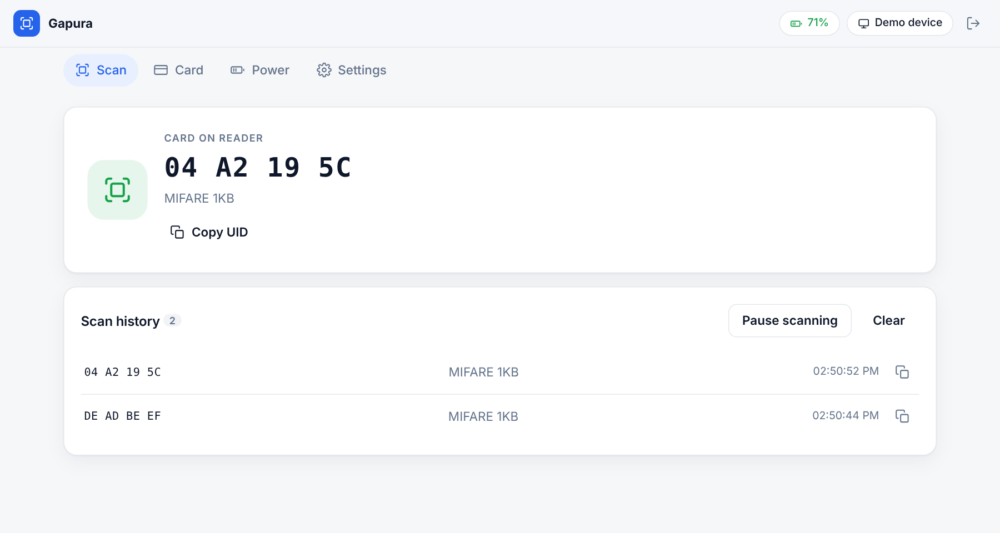
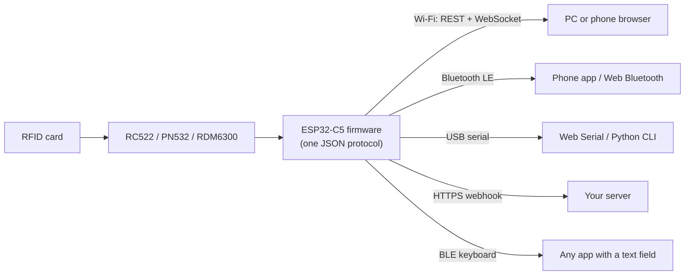

<p align="center">
  
</p>

<h1 align="center">Gapura</h1>

<p align="center">
  <b>Open-source wireless RFID reader/writer.</b><br/>
  ESP32-C5 with RC522, PN532 or RDM6300, usable from any phone or PC over Wi-Fi, Bluetooth LE or USB.
</p>

<p align="center">
  <a href="https://github.com/SkillsHUB-Electronics/gapura/actions/workflows/ci.yml"></a>
  <a href="https://github.com/SkillsHUB-Electronics/gapura/actions/workflows/pages.yml"></a>
  <a href="https://github.com/SkillsHUB-Electronics/gapura/releases"></a>
  <a href="LICENSE"></a>
  
  
</p>

<p align="center">
  <a href="https://skillshub-electronics.github.io/gapura/?demo"><b>Try the dashboard demo</b></a> ·
  <a href="#quick-start">Quick start</a> ·
  <a href="docs/PROTOCOL.md">Protocol</a> ·
  <a href="docs/PLAN.md">Plan and roadmap</a> ·
  <a href="CONTRIBUTING.md">Contributing</a> ·
  🇮🇩 <a href="README.id.md">Bahasa Indonesia</a>
</p>

<p align="center">
  <picture>
    <source media="(prefers-color-scheme: dark)" srcset="docs/images/dashboard-dark.png">
    
  </picture>
</p>
<p align="center"><em>The Gapura dashboard in demo mode. The same page runs from the device itself at <code>http://gapura.local</code>.</em></p>

---

## Why Gapura

Most RFID readers are tied to one PC over one cable. Gapura is a small battery-powered reader that any phone, tablet or PC can use over the link it already has, with one JSON protocol for all of them. Use it as a fixed reader that posts card taps to your server, or as a mobile reader that types the card ID into any app like a Bluetooth keyboard.

## Features

- **Read and write cards:** MIFARE Classic 1K and NTAG/Ultralight (13.56 MHz), plus 125 kHz EM4100 UIDs with an RDM6300.
- **Three links, one protocol:** Wi-Fi (REST + WebSocket, `http://gapura.local`), Bluetooth LE (Web Bluetooth and mobile apps), USB serial (Web Serial and scripts).
- **Built-in web dashboard:** mobile-first, served from the device, also [online](https://skillshub-electronics.github.io/gapura/) over Bluetooth or USB in Chrome and Edge.
- **Fits into existing systems:** HTTPS webhook on every tap, or BLE HID keyboard mode that types the card ID.
- **Card security:** per-card keys and a signed credential (HMAC) stored on the card, bound to the card UID, so edited data or data copied to another card is rejected.
- **Battery powered:** 18650 cell with the onboard charger, battery level and charge state, deep sleep on critical battery.
- **Safe by default:** block 0 and sector trailers are write-protected, BLE needs passkey pairing, the API needs a device password.
- **Maintainable:** over-the-air updates (firmware and dashboard), watchdog, CI builds and native unit tests.

## How it works



## Hardware

| Part | Notes |
|---|---|
| Waveshare ESP32-C5-WIFI6-KIT (N16R8) | Main board, onboard ETA6098 charger and MX1.25 battery header |
| RC522 or PN532 (13.56 MHz) | MIFARE Classic, NTAG, Ultralight |
| RDM6300 (125 kHz), optional | UID only, powered by an MT3608 5 V boost switched by GPIO 5 |
| 18650 cell, 2000 mAh | Battery voltage read on GPIO 6 |
| INA219, RGB LED, buzzer | Optional: current measurement, status light, beeps |

Pin map and power path: [docs/PLAN.md §1](docs/PLAN.md#1-components). Wiring diagrams for each reader mode (RC522, PN532, RDM6300, RC522 + RDM6300, PN532 + RDM6300) are in [docs/wiring/](docs/wiring/). Choose the mode in the dashboard under **Settings → Card reader**.

## Quick start

Prerequisites: VS Code + PlatformIO, Node.js 20+, Python 3.10+, Chrome or Edge (for Web Serial and Web Bluetooth).

```bash
git clone https://github.com/SkillsHUB-Electronics/gapura.git
cd gapura

# 1. Firmware
cd firmware && pio run -t upload && pio device monitor

# 2. Dashboard (served by the device from LittleFS)
cd ../dashboard && npm ci && npm run build
cd ../firmware && pio run -t uploadfs
```

First boot without Wi-Fi settings opens the hotspot `Gapura-Setup-XXXX` (password `rfid1234`). Browse to `http://192.168.4.1`, enter your Wi-Fi name and password, then open `http://gapura.local` and sign in with the default device password `rfid1234` (Bluetooth passkey `123456`). **Change both in Settings.**

No hardware yet? Run `npm run dev` in `dashboard/` and open `http://localhost:5173/?demo` for a simulated reader.

## Protocol

Every link speaks the same JSON messages (one per line over USB and BLE):

```jsonc
{ "id": 1, "cmd": "battery" }
{ "id": 1, "ok": true, "data": { "v": 3.92, "mA": 145, "pct": 78, "state": "discharging" } }
{ "event": "tag", "data": { "uid": "DE AD BE EF", "type": "MIFARE 1KB", "reader": "rc522" } }
```

Full contract: [docs/PROTOCOL.md](docs/PROTOCOL.md). Command-line client for USB: `python tools/rfid_cli.py --port COM11 ping`.

## Repository layout

```
firmware/    ESP32 firmware (PlatformIO, Arduino core 3)
dashboard/   web dashboard (Vite + TypeScript, no UI framework)
docs/        plan, protocol, wiring diagrams, images
tools/       USB test client and wiring diagram generator (Python)
3d/          case and part models (CAD)
```

## Documentation

| Document | What it covers |
|---|---|
| [docs/PLAN.md](docs/PLAN.md) | Components, pin map, power path, architecture, phases and remaining work |
| [docs/PROTOCOL.md](docs/PROTOCOL.md) | JSON commands, responses and events for every link |
| [docs/wiring/](docs/wiring/) | Wiring diagram for each reader mode |
| [CHANGELOG.md](CHANGELOG.md) | What changed in each release |
| [CLAUDE.md](CLAUDE.md) | Short project context for AI assistants and new contributors |

## Troubleshooting

| Symptom | Fix |
|---|---|
| Installing the ESP32-C5 framework fails with `FileNotFoundError` under `.platformio\.cache` on Windows | Path length limit inside the PlatformIO home. Use a short core dir: `set PLATFORMIO_CORE_DIR=C:\pio` |
| Build fails with `No such file or directory` inside `NimBLE-Arduino` on Windows | The project path is too long (260-character limit). Use a short workspace: `set PLATFORMIO_WORKSPACE_DIR=C:\pio-ws\gapura` |
| `boot` event shows `rc522: "0x00"` or `"0xFF"` | Check the SPI wiring and the 3.3 V supply of the RC522 |
| `gapura.local` does not open | Some Android versions lack mDNS; use the IP address from `info` |
| Web Bluetooth missing on iPhone | Safari has no Web Bluetooth; use Bluefy or a native app |

Still stuck? See [SUPPORT.md](SUPPORT.md).

## Roadmap

Open work is tracked in [docs/PLAN.md §4.1](docs/PLAN.md#41-remaining-work). Next up: HTTPS webhook against a production server, battery calibration, a dashboard redesign, and later MQTT for fleets of readers.

## Contributing

Contributions are welcome, from bug reports and wiring photos to firmware and dashboard changes. Read [CONTRIBUTING.md](CONTRIBUTING.md) to get started, and follow the [Code of Conduct](CODE_OF_CONDUCT.md).

## Security

MIFARE Classic (Crypto1) is not secure. Do not use Gapura for payments or high-security access control. To report a vulnerability, follow [SECURITY.md](SECURITY.md) and do not open a public issue.

## License

Gapura is released under the [MIT License](LICENSE). Third-party CAD models in `3d/` keep their original authors' licenses.
